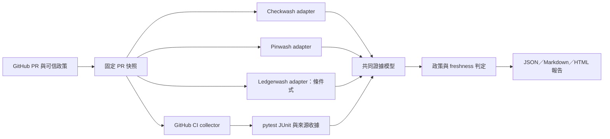

# PR 驗收證據工具：v0.1 產品與工程規劃

規劃日期：2026-10-29（Asia/Taipei）。這是建議的首版範圍與驗收契約，尚未建立新 repo、實作、部署或執行驗收。`delivery-review` 是文件中的工作名稱與預定 CLI 名稱，尚未決定正式品牌。

## 1. 產品承諾與第一批使用者

**讓經常使用 coding agent 的開發者，針對一個固定版本的 GitHub PR，看清楚驗收證據是否齊全、是否對應本次修改，以及還有哪些問題需要處理。**

第一批使用者是維護 Python 專案、使用 GitHub Actions／pytest、會自行審查 Agent PR 的個人或小團隊。第一版圍繞一次 PR 查核，人工保留最終驗收權。

報告回答四個問題：

1. 哪些必要檢查已完成，證據對應哪個版本？
2. 測試或驗證設定是否被削弱，是否新增豁免？
3. 哪些資料缺失、過期、矛盾或不支援？
4. 使用者現在需要處理哪幾項事項，原始依據在哪裡？

**成功標準是降低人工核對成本。** 產品輸出的「可進入人工驗收」只表示滿足這份有限政策所需的證據，並非證明任務完整、需求正確或產品沒有 bug。

## 2. v0.1 範圍決策

| 項目 | 首版決策 |
|---|---|
| 入口 | 本機 CLI，輸入 GitHub PR URL；可讀取使用者有權限存取的公開／私有 repo |
| 初始完整支援 | GitHub.com、GitHub Actions、Python／pytest JUnit；驗收器先支援 Linux／Python 3.11，一般 Windows 使用者走 WSL2 |
| 輸出 | `report.json`、Markdown 摘要、自包含 HTML 報告、原始證據與雜湊清單 |
| 操作模式 | 唯讀查核；不執行被查核 PR 的測試、安裝程式或專案腳本 |
| Checkwash／Pinwash | 對固定 PR diff 執行已安裝、已鎖版的靜態分析 CLI |
| Ledgerwash | 僅在存在支援格式的帳本時啟用；是否必需由事前政策決定 |
| CI 資料 | 讀取既有 run／attempt／job／check／artifact；支援標準 producer 收據 |
| 人工政策 | 使用可信任位置的固定政策檔；不以 PR HEAD 的設定放寬本次要求 |
| 發布方式 | 可安裝 Python 套件、三引擎隔離安裝說明、GitHub Actions producer 範本、範例報告 |
| 明確延後 | SaaS、GitHub App、多租戶、排程服務、自動合併、自動修復、PR 留言／Check 發布、完整 session 還原、任意自然語言需求判定、通用帳本、跨 CI、模型訓練 |

首版只宣稱通過實測的平台與格式。掃描器原本支援更多語言，不等於新產品已接受那些語言的完整 CI／測試資料鏈。

**一次設定後，才能對「證據完整」作判斷。** 沒有政策的 PR 仍可讀取並展示觀察結果，但要顯示「尚未設定驗收要求」，不能從目前看到的成功 jobs 反推所有必要工作都完成。

## 3. 使用流程與畫面內容

預定命令如下，屬於待實作介面：

```text
delivery-review inspect PR_URL --policy PATH --out NEW_DIRECTORY
delivery-review replay REPORT_DIRECTORY
delivery-review refresh REPORT_DIRECTORY --out NEW_DIRECTORY
```

- `inspect`：驗證政策與工具 lock，取得 PR 快照，分析固定 diff，收集 CI 證據，套用政策，最後再檢查 freshness。
- `replay`：只使用保存的資料與相同政策重算；檢查雜湊與格式。離線回放不聲稱知道 GitHub 現況。
- `refresh`：向 GitHub 重新取證並建立新報告，保留舊報告；不覆寫歷史。

報告首頁依序呈現：

1. PR、完整 head／base 身分、查核時間，以及本報告的支援範圍。
2. 「資料完整度」「版本是否仍適用」「阻擋／待人審事項」三個獨立狀態。
3. 最多先展開五項待處理事項，每項附原因、來源連結與下一步。
4. 必要檢查表：要求、觀察結果、來源版本、run／attempt、證據缺口。
5. 各引擎 findings、覆蓋限制、原始報告與工具版本。

示例文案：

> 資料不足，尚不能進入人工驗收。Python 3.11 測試有執行紀錄；Python 3.12 job 被略過。另有一筆新增豁免需要確認。這份報告適用於 head `…`，查核結束時版本未變。

HTML 不載入外部腳本；對 repo 名稱、finding、XML 內容與連結作適當跳脫。報告不把原始 artifact 當 HTML 或腳本執行。

首版必交付輸出只有 JSON／Markdown／HTML／原始證據 manifest。RDJSON 與 unsigned in-toto export 是核心完成後才可追加的選配，不列 M3 或發布門檻；若未完成，仍可按既定範圍發布 v0.1。

## 4. 現有 repo 怎麼接



### 4.1 引擎採用原則

新產品放在獨立 repo。三個 Wash 保持自己的版本、規格、發行與測試。新產品透過正式 CLI／JSON 整合，以外層 adapter 補足來源身分；不直接 import 私有函式，不複製 detector，不在首版改動其判決規則。

初始候選套件如下。它們已存在於 PyPI；下列 wheel SHA-256 是本次從 PyPI 版本 API 讀到的紀錄，**尚未下載檔案驗算或完成 adapter 相容性驗收**。實作時須獨立驗算後才納入正式 lock。

| 引擎 | 候選版本 | 首版接法 | 必須保留 |
|---|---|---|---|
| Checkwash | 0.10.0 | 用正式 JSON 介面掃描固定 merge-base／head；另保留該版本的 coverage 輸出與 stderr | 原 verdict、findings、fingerprint、allowlist 狀態、skipped／unread／config errors、門檻與原始 JSON |
| Pinwash | 0.1.1／SPEC 29，GitHub release 標為 prerelease | `pinwash check MERGE_BASE..HEAD`；這是 PR diff 檢查，不使用需要事前基準的 `session review` | unknown coverage、config errors、工具／spec 身分、原判決；新增 exemption 另列待人審 |
| Ledgerwash | 0.5.0／SPEC 5 | 對固定 head 執行支援的 `ec-ledger` 掃描 | finding verdict、coverage、residuals、adapter／epoch identity；不能只讀總 exit code |

候選 wheel 雜湊：

```text
checkwash-0.10.0-py3-none-any.whl
3522d641d589ff9b75ad5e2f510d0884ca2520c32265d8397f0fcef226bc1171

pinwash-0.1.1-py3-none-any.whl
d002160a73f5affbd4cf3446f676aa2809ef006a12feff77cab5edb4a8c62e03

ledgerwash-0.5.0-py3-none-any.whl
5a38efe79c38f8d4e2ea25dae231d174e597ffbc5ee2e3df4d312fdb7bc128e9
```

Checkwash 0.11.0 正式發行後，可另做升級相容性測試再替換 lock；首版不等待它。#419 等既有漏報要如實揭露，不列為本產品發布的修復前置條件。

沒有帳本時，Ledgerwash 顯示 `not_provided`；有帳本但格式不支援則顯示 `unsupported`。若政策未要求帳本，這不單獨阻止人工驗收；若政策要求，則造成缺失義務。不得製造空帳本取得表面通過。

每次 adapter 執行保存工具／契約／adapter 版本、套件 digest、設定與門檻、比較 SHA、完整 argv、原始 exit、stdout／stderr 摘要與原始報告 digest。timeout、未知 schema、無法解析、輸出過大皆是明確錯誤。正規化不得抹掉原始 findings。

### 4.2 其他現有 repo 的角色

| 資產 | 首版用法 | 邊界 |
|---|---|---|
| Checkwash receipt bridge | 參考 manifest、完整 source／base 綁定、JUnit／套件 digest、live PR 重查的實作 | 其 repo、主機、測試命令與本地收據格式綁定特定環境；首版不直接搬作通用 collector |
| checkwash-corpus | 建立 adapter 回歸、窄 oracle 反例與報告範例 | 不當 runtime 資料庫，也不把所有歷史標籤當成獨立真值 |
| ec-reference | 參考 API 身分、run／attempt、artifact digest、重放與缺證據處理 | 現有 executor 支援固定 bounded-sha256 工作；首版不引入任務治理與派工服務 |
| PTC、其他研究工具 | 首版無 runtime 依賴 | 避免新產品重新進入語意證明研究 |

已確認 Pinwash、Ledgerwash 的 PyPI 套件可讀取；使用者安裝路徑不應依賴存取私有 GitHub 原始碼。PyPI 上隨套件保留的舊 README 有過時發布敘述，安裝文件應以具體版本 API／檔案、發布收據及實測為準。

## 5. 開源專案：採用層級與理由

| 專案／介面 | v0.1 決策 | 具體用途 |
|---|---|---|
| GitHub CLI／GitHub REST API | 直接介接；初版透過固定支援版本的 `gh api`，以 provider adapter 包裝 | 沿用使用者登入，讀 PR、run、job、check、artifact；JSON 資料可保存與回放；不輸出 token |
| actions/upload-artifact | producer 範本的直接依賴；採用已驗證 release 的完整 commit pin | 上傳 receipt 與 JUnit，取得 artifact ID／digest；collector 自己走 REST 取回 |
| actions/download-artifact | 首版本機 collector 不依賴；未來 hosted collector 可用 | 借其 immutable artifact 與 digest 核對方式；不要只依名稱選檔 |
| in-toto/attestation | 採 Statement v1 的封裝設計與 schema；v0.1 提供可選 unsigned export | `subject` 綁到 evidence manifest 的 digest，自訂 predicate 放 snapshot、政策與判讀；自訂 predicate URI 在新 repo 確定後固定版本 |
| reviewdog | 借 RDJSON／SARIF mapping 與 reporter 設計；v0.1 可輸出 RDJSON，遠端發布延後 | findings 可接既有 PR 顯示工具；整體缺 job／過期證據仍留在產品主報告，不受 diff filter 隱藏 |
| dorny/test-reporter | 設計參考，非 Python runtime 依賴 | 借 parser 分層、suite／case 結構、Checks 呈現；不複製 TS parser，也不沿用「沒有 failed 就 success」作驗收判準 |
| SWE-bench | 評估方法參考，非 runtime 依賴 | 借固定 base、FAIL_TO_PASS／PASS_TO_PASS 與可重跑環境；不把公開榜單或 benchmark 通過當產品驗收 |
| GitHub artifact attestation／`gh attestation verify` | v0.1 原樣保留相關連結；完整驗證 adapter 列入 v0.2 | 有些專案沒有 attestation，不能將缺席自動當失敗；後續驗證身分、issuer、來源與 digest，保留聲明內容的信任界線 |
| OPA、Cosign、Allure／ReportPortal | 延後 | 多租戶政策、跨 CI 簽章或長期測試分析出現實際需求時再採用 |

reviewdog、dorny、GitHub artifact actions 為 MIT；in-toto、三個 Wash 中的 Checkwash／Ledgerwash 為 Apache-2.0，Pinwash 為 MIT。借鑑設計與直接移植程式碼須分開記錄；移植時保留對應 LICENSE／NOTICE。第三方 patch 的權利不因被 corpus 收錄而改變。

目前 slsa-framework/slsa-verifier 已明示不再積極維護，不列新產品依賴。來源驗證需求先沿 GitHub 官方支援途徑規劃。

## 6. 必須新增的核心

### 6.1 Snapshot 與不同來源版本

保存 numeric repository ID、PR number、head repository ID、base tip SHA、head SHA、merge-base SHA，以及可取得時的 merge commit SHA。所有 SHA 使用完整值。

掃描 diff 固定為 `merge_base..head`。base tip 是當時目標分支的位置，不能和 merge-base 混為一談。引擎原生從 BASE 讀取的政策／allowlist 語意須保留；若外層政策要求較新的 base-tip 規則，而引擎只能採 merge-base 規則，須標示基準政策差異，未解決前不得宣稱滿足該要求。

CI 分開保存：GitHub run 的 source metadata、check 顯示的 SHA、受信任流程所宣告的 checkout SHA，以及實際能核對到的證據。PR head 與 GitHub merge commit 都是可能的受測來源。首版只接受：

- 政策允許的 PR head；或
- 經 Git commit API／本地 Git 物件確認父鏈吻合本次 base tip 與 head 的兩親 merge commit。

自訂 merge、merge queue、octopus merge 或來源無法對應時，保留資料並標示不支援／未確認，不猜測等價。

### 6.2 可信政策與必要檢查清單

政策在 PR 外的可信位置保存，或由操作者明確指定已批准 commit 的 blob。記錄原始 bytes 與 digest。至少設定：

- repo 身分與允許的來源模式；
- required workflow ID／path、event、來源 workflow 版本與必要 job／matrix cells；
- run／attempt 選取規則、報告 artifact／receipt 格式；
- 必要掃描器、固定版本、門檻、coverage 要求；
- 是否要求 Ledgerwash、是否容許已知 skip、最低測試數或指定測試集合；
- API、下載、parser、scanner 的資源限制。

未設定的範圍不得顯示為「已完整驗證」。PR 內修改驗收政策只產生待審差異，不能替自己免除要求。沒有通用「忽略一切」按鈕；首版的豁免走既有引擎契約或外部政策審閱。

### 6.3 GitHub collector 與執行選取

以 workflow ID／path、event、repo ID、run ID、attempt、job ID、App ID、check SHA、artifact ID／digest 識別證據。單看名稱、綠勾或最新成功時間均不足。

同一 workflow 與 snapshot 有多次 run 時，選最新適用 run；該 run 選最新 attempt。最新仍在跑、失敗或來源不符合政策時，保留舊成功為歷史，不能跳過最新結果後回退挑綠燈。選取規則與來源信任檢查分開記錄。每個必要 workflow 可以有自己的 run，但必須滿足相同 snapshot／政策，單一 workflow 不拼接不同 attempts 的成功片段。

必要 job／matrix cell 缺席、skipped、cancelled、neutral、timeout、無權限、artifact 過期分別保留。API 需完整處理分頁；超出限制是資料不足，不能把第一頁當全量。重跑期間 attempt 改變也必須刷新。

開始與結束重讀 head／base，必要 run 的 attempt 也重查；變動則整份舊 snapshot 標 stale。離線報告附查核時間，日後使用前需 refresh，不能把靜態 HTML 當即時承諾。

### 6.4 Producer 收據與 pytest JUnit adapter

對既有任意 workflow，先提供 API metadata 層級的觀察。若要達到政策要求的受測來源與測試內容完整度，提供由操作者批准、固定版本的 reusable workflow／collector 範本。

範本記錄：repo／base／head／checkout／workflow 身分、run／attempt／job、測試命令、退出碼、JUnit 檔案 digest、測試計數。setup、pytest 與報告收集各自保留結果，不能讓最後的成功 upload 覆蓋前面的失敗。

PR 的測試程式仍可影響測試報告；來源收據只在已聲明的 runner／workflow 信任範圍內提供支持。Artifact hash 證明 bytes 一致，API 證明平台的關聯紀錄，兩者均不單獨保證 JUnit 內容真實。

每筆證據另標來源級別：`reported`＝只有輸入聲明；`platform_bound`＝可由 API 與 digest 核對平台紀錄；`workflow_bound`＝另符合操作者批准的 producer workflow／來源契約。首版預設的「測試來源已確認」義務要求 `workflow_bound`，單憑 PR 內自行上傳的收據不得升級。這些等級均不命名為密碼學認證。Unsigned in-toto export 顯示「未簽署聲明」，不會提升原證據級別。

`workflow_bound` 必須由 collector 獨立取得 run／attempt metadata，核對 GitHub `referenced_workflows` 的實際 path／SHA 與政策批准的 reusable workflow 完整 commit，再核對該版本的來源選取與 collector 契約、job／artifact 綁定及收據中的來源。缺少平台可核對的 workflow 版本，或來源來自任意 PR 自選命令，皆不得升級。這表示「受測來源有符合已批准流程的聲明」，不表示能偵測受信任 workflow 本身有 bug 或測試程式造假；這個名稱與限制需在報告中同時呈現。

JUnit 首版只接受已測過的 pytest dialect：passed／failed／error／skipped、suite／case identity、時間與計數。拒絕 DTD／外部實體，不解析任意 XML 擴充。空檔、零測試、全 skipped、collection／setup error、重複 testcase identity、總計不一致均須有明確結果。部分 skips 是否允許，由固定政策判斷。

### 6.5 共同資料契約與純函式判讀

建議 `report.schema.json` 至少包含下列概念，正式欄位與枚舉在第一階段凍結：

```text
schema_version / report_id / observed_at
subject: repository IDs, PR, base_tip, merge_base, head, merge
policy: id, source revision, digest, required obligations
collector: version, source/artifact identity
engines[]: identity, invocation, exit, raw report digest, findings, coverage
evidence[]: provider, workflow, run, attempt, job, artifact, tested source,
            binding level, source links, observation, retrieval errors
obligations[]: requirement, matched evidence IDs, result, reasons
state: evidence, freshness, policy
action_items[] / limitations[] / raw_inventory
```

原始觀察、來源可信度、政策判定三者分開。每個 finding 保留 `engine + engine_version + fingerprint`，避免不同工具相同字串被錯誤合併。共同格式未涵蓋的原始欄位仍保存在 raw report。

建議三維狀態：

| 維度 | 值 | 意義 |
|---|---|---|
| evidence | complete / incomplete / error | 只對事前宣告的必要義務判定，個別項目另外保留 pending／missing 等細節 |
| freshness | current / stale / unknown | 是否仍對應最後觀察到的 PR／執行快照；離線回放不更新 current 的觀察時間 |
| policy | clear / review / block | 是否存在待處理的人審或阻擋 finding；可和 evidence error 同時存在 |

只有 `complete + current + clear` 可顯示「可進入人工驗收」。不產生通用 confidence 分數。

預定 exit code：0＝可進入人工驗收；1＝資料完整且仍適用，但有 review／block；2＝資料不足、過期或執行錯誤。JSON 始終保留全部維度，exit 2 不得隱藏已找到的阻擋事項。

### 6.6 執行與資料邊界

collector 使用必要的 repo 讀取權限；首版不需要寫 PR、Checks、內容或 OIDC 的權限。GitHub 憑證只在 API provider 邊界使用，不傳給 scanner／XML parser。不要在帶憑證的 verifier 中執行 PR 的安裝與測試。

Git 來源由新建的受控 checkout／object store 取得，不信任使用者專案的 Git hooks、filter、config、cache 或 Python path。固定安裝的 scanner 在隔離 subprocess 執行，清除主題 repo 對 import 的影響，設定 deadline 與輸出上限。

Artifact 僅讀取 manifest 指定的 JSON／XML；限制下載大小、解壓總量、檔案數與路徑，拒絕 traversal、symlink、重複名稱與格式不符。報告保存選定原始證據，不預設下載全部日誌，也不存 token 或帶憑證的下載網址。

初始可調限制建議：單 artifact 25 MiB、解壓總量 100 MiB、最多 100 個檔案；每引擎 120 秒。超限回傳明確 incomplete／error，不放寬成成功。正式預設須用試用資料確認，這些是計畫值而非效能實測結果。

## 7. 資料庫與驗收資料怎麼用

| 資料 | 用途 | 不應承擔的主張 |
|---|---|---|
| 1,117 個 `.gwcase`、3,600 歷史 diffs | adapter／schema／報告升級回歸；先選代表性子集，版本變更時再擴大比較 | 獨立的未知 repo 準確率 |
| 80 tamper、60 refactor、stress reproducers | 已知弱化／合法變動的窄 oracle 對照；保留既有逃逸 | 完整語意等價或自然發生率 |
| corpus probe 的 FIXED／WEAKENED／FAILED 方法 | 學習如何把原始測試、Agent production 與 Agent tests 分開驗證 | 對任意需求的完成證明 |
| harvested PR patches | 真實格式、來源連結、呈現與匯入案例 | PR 合併即代表正確的標籤 |
| 630 Claude edits | 內部研究提醒成本；保留暫定標籤身分 | 首版公開訓練集或獨立準確率樣本 |

新增 `delivery-cases` 集合，保存來源快照、政策、API responses、raw reports、預期狀態與標籤方法。受控構造案例可作故障驗收；真實案例用人工核對，兩者分開統計。

先挑約 30–50 個既有代表案例作 adapter／呈現回歸，再補下面的完整交付控制案例。這是建議的起始規模，不代表已建立該資料集。

## 8. 首版端到端驗收表

| ID | 情境 | 必須觀察到的結果 |
|---|---|---|
| E01 | 固定來源，所有必要 jobs、receipt、報告與掃描完成 | complete／current／clear；每項結論可回溯來源 |
| E02 | 成功 CI 屬於前一個 head | 舊證據 stale，不得借用為本次完成 |
| E03 | 合法 merge commit 及父鏈不吻合的反例 | 前者按政策接受；後者來源未確認 |
| E04 | 收集中 head、base 或最新 attempt 改變 | 舊報告 stale；需 refresh |
| E05 | PR 修改門檻、必要 job、allowlist 或外層政策 | 原政策繼續生效；差異可見／待審 |
| E06 | required workflow／job／matrix cell 缺席 | incomplete |
| E07 | 必要檢查 skipped／neutral／cancelled／timeout | 保留各狀態，不能當必要成功 |
| E08 | 同名 check 來自錯誤 App／workflow 或匹配有歧義 | 不冒認；incomplete |
| E09 | 舊 run 成功，新 run／attempt pending 或 failure | 不拼接最佳片段、不回退拿綠燈 |
| E10 | receipt／artifact digest、run、attempt、source 被替換；或自洽收據宣稱來源但無法獨立確認 producer 版本 | 拒絕不符證據；自述一致不得升級 workflow_bound 或滿足要求該級別的義務 |
| E11 | scanner timeout、exit 2、損壞 JSON、未知 schema | error／incomplete，保留已有 findings |
| E12 | skipped／unread files、unknown coverage | 缺口可見；依政策限制完整主張 |
| E13 | 弱化、合法重構、既有有效豁免、新增豁免 | 保留各引擎原判決；新增豁免待審 |
| E14 | exit 0 但零測試／全 skipped／collection error／缺 JUnit | 不能當必要測試已通過 |
| E15 | 無帳本、未知帳本、支援帳本但 coverage 不完整 | 區分 not_provided／unsupported／gaps，按必要性計算 |
| E16 | 惡意 archive 路徑／symlink、XML 實體、超大檔案、HTML 字串 | 拒絕或安全呈現；不執行內容 |
| E17 | 原始檔案被竄改、離線 replay、重新 refresh | digest 不符拒絕；replay 不冒稱即時；新舊報告各自保留 |
| E18 | known #419 escape 與不支援來源模式 | 如實呈現能力限制，不把修 detector 當本版通過條件 |

E01 需要在實際、專用的簡單 Python repo 上完成一次 GitHub Actions → artifact → 本機報告流程。Checkwash 自身的本地主機收據流程有專用格式，不適合作為唯一 happy-path 範例；首版先用標準 hosted workflow。任何 live fixture repo／workflow 執行均屬後續實作工作，本規劃沒有建立或啟動它們。

## 9. 工作分期、依賴與完成條件

| 階段 | 新 repo 的工作 | 完成條件 |
|---|---|---|
| M0：契約 | 產品範圍、policy／report／receipt schema、狀態機、候選工具 lock、固定 API fixtures | E01–E18 預期先寫好；明確區分來源觀察與判定；未知資料不落入成功 |
| M1：取證與回放 | GitHub provider、snapshot／merge-source 對應、run／attempt 選取、分頁、artifact 邊界、raw evidence store | 錯 SHA／錯 attempt／缺 job／篡改 artifact 控制通過；同資料重放得到同決策 |
| M2：引擎與政策 | 三個 CLI adapters、工具版本驗證、policy evaluator、coverage／hold 語意 | 代表案例原始 findings 保留；optional Ledgerwash 不妨礙普通 repo；必要但缺失會阻止完整 |
| M3：產品流程 | pytest producer 範本與 parser、CLI、JSON／HTML／Markdown、原始 manifest、refresh | 一個標準 GitHub Actions repo 可端到端使用；原始證據可點回；E01–E18 全部有紀錄 |
| M4：試用與發布 | 文件、安裝與隔離環境、pilot、修復、版本化發行 | 支援平台的乾淨安裝成功；故障控制零誤升 complete；試用問題已記錄與處理 |

M0 先凍結，再並行開發 M1 與 M2；M3 依賴兩者接合。以完成條件推進，暫不承諾日曆工期。先前提到的兩週只適合縮小的原型探索，不應視作本計畫完整發布承諾。

建議新增檔案責任：

```text
src/delivery_review/
  cli.py
  snapshot.py
  providers/github.py
  evidence/store.py
  evidence/binding.py
  adapters/checkwash.py
  adapters/pinwash.py
  adapters/ledgerwash.py
  adapters/pytest_junit.py
  policy.py
  report.py
schemas/
tests/contracts/
tests/e2e/
fixtures/delivery_cases/
examples/policies/
examples/workflows/
docs/
```

不建立常駐資料庫服務。首版每次查核建立新的 evidence directory＋manifest，程式不覆寫既有報告；這不代表能抵抗擁有本機寫入權限者同時修改資料與 manifest。歷史查詢需求明確後再評估 SQLite。

## 10. 發布與產品驗收

工程門檻：

- E01–E18 有固定 input、預期與原始結果；故意缺失／替換證據的控制案例，零個被升成 complete。
- 三個支援版本的正式套件完成獨立下載驗算、隔離安裝與契約測試。候選 wheel 的 PyPI metadata 不是完成驗收的替代品。
- 報告中所有結論能追到 snapshot、policy、原始 finding 或 CI 證據；錯誤不被 summary 覆蓋。
- freshness、API pagination、資源限制、無權限、過期 artifacts 與部分失敗皆有控制案例。
- 套件與報告在實際宣告的 Linux／Python 3.11 環境驗收；其他平台標明未驗收。
- 文件清楚揭露引擎已知限制、來源收據信任範圍與使用者仍需做的人工驗收。

產品試用目標：3 位有此工作流的使用者、至少 3 個 repo、15 個新 PR。這是探索門檻，不能據此發布整體準確率。

逐案記錄：人工原本核對時間、看報告後核對時間、無效提醒、漏掉的關鍵缺口、結論是否可追溯，以及是否主動在下一個 PR 再使用。建議進入下一版的產品條件為：至少兩位願意重複使用，並有可記錄的核對時間或遺漏改善；若只有研究團隊自己看得懂，先改善接入與報告。

凍結首版後另取新的外部完整交付案例，先定義評分標準與人工標註。用來修改產品的案例轉入回歸集，不繼續稱為 held-out。

## 11. 主要依據

以下是規劃依據與本次檢視版本；查閱文件與原始碼不等同本輪重跑各專案驗收。

- [Checkwash embedding 契約](https://github.com/taipei49314/checkwash/blob/6a867f6dc89c69c116bbf90be69f7a7681bed80c/docs/embedding.md)、[receipt bridge](https://github.com/taipei49314/checkwash/blob/6a867f6dc89c69c116bbf90be69f7a7681bed80c/docs/pju-receipt-bridge.md)、[R29](https://github.com/taipei49314/checkwash/blob/6a867f6dc89c69c116bbf90be69f7a7681bed80c/docs/r29-comparison-0.10.0.md)。
- [Pinwash consumer](https://github.com/taipei49314/pinwash/blob/ea185125565f2ef5b5b023c02039d1b00e40b462/pinwash/consumer.py)、[0.1.1 release](https://github.com/taipei49314/pinwash/releases/tag/v0.1.1)、[PyPI 版本 API](https://pypi.org/pypi/pinwash/0.1.1/json)。
- [Ledgerwash engine](https://github.com/taipei49314/ledgerwash/blob/d8cbb8cdcb2eb7376a6799425e40d56fe173224c/src/ledgerwash/engine.py)、[coverage](https://github.com/taipei49314/ledgerwash/blob/d8cbb8cdcb2eb7376a6799425e40d56fe173224c/src/ledgerwash/coverage.py)、[PyPI 版本 API](https://pypi.org/pypi/ledgerwash/0.5.0/json)。
- [Checkwash 0.10.0 發行](https://github.com/taipei49314/checkwash/releases/tag/v0.10.0)、[PyPI 版本 API](https://pypi.org/pypi/checkwash/0.10.0/json)。
- [checkwash-corpus](https://github.com/taipei49314/checkwash-corpus/blob/86ffe1560d72356f6e59a032d1c84c061753c06a/README.md)、[EC executor](https://github.com/taipei49314/ec-reference/blob/a7a13558d43bea844d0b7b3b3369d968651ca6b3/docs/EXECUTOR.md)。
- [GitHub PR／workflow 事件](https://docs.github.com/en/actions/reference/workflows-and-actions/events-that-trigger-workflows)、[Artifacts REST API](https://docs.github.com/en/rest/actions/artifacts)、[gh API](https://cli.github.com/manual/gh_api)。
- [GitHub workflow run 與 referenced_workflows 的實際 SHA](https://docs.github.com/en/rest/actions/workflow-runs?apiVersion=2026-03-10)。
- [reviewdog v0.21.2](https://github.com/reviewdog/reviewdog/releases/tag/v0.21.2)、[RDJSON schema](https://github.com/reviewdog/reviewdog/blob/master/proto/rdf/reviewdog.proto)。
- [dorny/test-reporter v3.0.0](https://github.com/dorny/test-reporter/releases/tag/v3.0.0)、[結果彙總實作](https://github.com/dorny/test-reporter/blob/v3.0.0/src/test-results.ts)。
- [upload-artifact v7.0.2](https://github.com/actions/upload-artifact/releases/tag/v7.0.2)、[download-artifact v8.0.2](https://github.com/actions/download-artifact/releases/tag/v8.0.2)。正式使用前仍需核對 runner/runtime 相容性並鎖完整 commit。
- [in-toto Statement v1](https://github.com/in-toto/attestation/blob/main/spec/v1/statement.md)、[GitHub attestation 驗證與信任邊界](https://cli.github.com/manual/gh_attestation_verify)、[舊 slsa-verifier 維護狀態](https://github.com/slsa-framework/slsa-verifier)。
- [SWE-bench 資料契約](https://www.swebench.com/SWE-bench/guides/datasets/)。
